# 🧪 Awesome Computational Chemistry & Biology 🧬

  

  
  
  
  
  
  

---

## 📌 Top Computational Chemistry & Biology Ecosystem

**A Curated Collection of Enterprise SaaS Platforms & High-Performance Open-Source GitHub Projects**  
*Comprehensive tools for Molecular Dynamics (MD), Protein-Ligand Docking, AI/ML Interatomic Potentials, Cheminformatics, Cryo-EM, and Macromolecular Structure Prediction.*

**Last updated: October 2026** 📅

This repository tracks premier **SaaS platforms** and **open-source software** powering modern **computational chemistry**, **structural biology**, and **computer-aided drug design (CADD)**. Researchers and bioinformaticians leverage these tools to perform multi-scale physics simulations, screen ultra-large virtual chemical libraries, simulate all-atom force fields, and deploy deep learning foundation models for biomolecular design.

---

## 📑 Table of Contents

- [📊 Sector Overview & Market Dynamics](#-sector-overview--market-dynamics)
- [🏢 SaaS & Hosted Commercial Platforms](#-saas--hosted-commercial-platforms)
- [💻 Open-Source GitHub Projects](#-open-source-github-projects)
- [🤝 How to Contribute](#-how-to-contribute)
- [⭐ Star History](#-star-history)
- [💖 Support & Sponsorship](#-support--sponsorship)
- [⚖️ Disclaimer & Software Licensing](#-disclaimer--software-licensing)

---

## 📊 Sector Overview & Market Dynamics

The global **computational biology and computational chemistry software market** is currently valued between **$8B and $10.7B**, projected to surge past **$30B by 2035** at a rapid **13%–17% CAGR**. Growth is strongly accelerated by AI foundation models (such as AlphaFold, ESM, and equivariant neural networks), next-generation sequencing (NGS), and high-throughput virtual screening in pharmaceutical biotechs.

The market structure is characterized as **moderately fragmented**:
- **Consolidated Enterprise Core:** A concentrated tier of established multinational engineering and life-science platform providers (e.g., Cadence/OpenEye, Dassault Systèmes BIOVIA, Schrödinger) capture ~35%–40% of industry software expenditures through comprehensive multi-year enterprise contracts with global pharma leaders.
- **Agile Innovation Periphery:** A fast-evolving, highly fragmented open-source and biotech startup layer pioneers specialized de novo design, free energy perturbation (FEP), cryo-EM processing, and equivariant machine learning potentials.

---

## 🏢 SaaS & Hosted Commercial Platforms

| Product / Platform | Company / Developer | Company Size (Rev / Valuation) | Pricing (Specific Starting Tiers) | Free Tier Limits / Trial Limits | Description |
| :--- | :--- | :--- | :--- | :--- | :--- |
| **[OpenEye Scientific (Cadence)](https://www.eyesopen.com/)** | Cadence Design Systems (NASDAQ: CDNS) | ~$5.30B revenue / ~$92B market cap | Paid Academic Package starts via custom quote; Orion cloud compute billed per second on AWS / Cadence OnCloud | **Free Public Domain Research License**: Free forever for accredited degree-granting academic research, but requires all results/data to be published to the public domain (no IP retention allowed) and includes no technical support. No self-serve commercial free trial. | Cloud-native Orion platform with ROCS (shape screening), EON (electrostatics), OMEGA (conformers), and FRED (docking). Ideal for custom computational pipelines on AWS/Cadence OnCloud. |
| **[BIOVIA Discovery Studio](https://www.3ds.com/products/biovia/discovery-studio)** | Dassault Systèmes (Euronext: DSY) | ~€6.24B (~$6.8B) revenue / ~$32B market cap | Annual subscription starts around ~$6,000/year for baseline configurations; commercial/academic simulation suites scale via custom enterprise quotes | **Discovery Studio Visualizer (Free Forever)**: Free standalone viewer with no expiration; restricted to viewing, sharing, and basic analysis of 3D macromolecular structures (excludes simulations, docking, and ADMET modules). Sales-approved enterprise evaluations available upon request. | Comprehensive molecular modeling platform featuring QSAR models, docking, protein modeling, and ADMET prediction. The enterprise standard for biopharma R&D. |
| **[Schrödinger PyMOL](https://www.pymol.org/)** | Schrödinger, Inc. (NASDAQ: SDGR) | ~$259M revenue / ~$1.8B market cap | **Academic single user**: $99/year (2-year: $198, 3-year: $297); **Commercial single user**: $1,050/year (2-year: $2,100, 3-year: $3,150) | **PyMOL Educational Build (Free Forever)**: Dedicated strictly to classroom instruction and coursework; legally prohibited from being used for academic research, data analysis, or publication; includes no Schrödinger tech support. Source code also available free under open-source license. | Industry-standard molecular visualization system (Incentive PyMOL) known for publication-grade graphics, ray tracing, and high-resolution rendering. |
| **[CHARMM](https://www.charmm.org/)** | Academic CHARMM Development / BIOVIA | ~$15M–$25M (Academic consortium / BIOVIA commercial distributor) | **Academic / Non-profit**: Free ($0); **Commercial (CHARMm)**: Proprietary enterprise licensing via BIOVIA custom quote | **Academic Version (Free Forever)**: Completely free of charge with all GPU acceleration and parallel scaling features, restricted strictly to non-profit, government, and degree-granting academic labs. Zero commercial usage permitted. | Pioneering molecular dynamics package featuring P21 periodic boundary conditions for membrane and biomolecular systems. Commercialized by BIOVIA. |
| **[AMBER](https://ambermd.org/)** | University of California, San Francisco / AMBER Developers | ~$10M–$20M (Consortium / institutional distribution) | **Academic / Non-profit / Gov**: Free ($0); **Commercial**: $25,000 perpetual for new licensees ($20,000 for upgrades/renewals) | **AmberTools (Free Forever)**: 100% free under GPL for all users (including commercial) for basic MD setup and analysis; full GPU-accelerated PMEMD package is free forever for non-profit and academic use. No commercial trial period. | Gold-standard molecular dynamics package for biomolecular simulation. Reference implementation for force field development and GPU-accelerated MD. |
| **[MOE (Chemical Computing Group)](https://www.chemcomp.com/)** | Chemical Computing Group (CCG) | ~$5M–$10M revenue (Private) | Paid annual subscription (academic discount via edu@chemcomp.com; commercial typically $10,000+ per seat annually) | **Institutional Free Trial**: Available upon request via institutional/corporate email verification; typically granted as a 14 to 30-day node-locked or floating evaluation key for testing all modeling features before purchase. | Molecular Operating Environment: comprehensive drug discovery platform covering docking, pharmacophore modeling, QSAR, and biotherapeutics design. |
| **[Spartan](https://www.wavefun.com/)** | Wavefunction, Inc. | ~$5M–$10M revenue (Private) | **Student Edition**: $60 perpetual; **Standard Academic**: $1,800 (≤16 cores) / $2,700 (>16 cores); **Commercial**: $5,400 (≤16 cores) / $8,100 (>16 cores) | **30-Day Free Trial**: Fully functional demo license for Spartan Parallel Suite or ODYSSEY, available to faculty and industrial chemists upon request (students must request via advisor). | Molecular modeling and computational chemistry software combining an intuitive GUI with ab initio and DFT quantum chemistry engines. |
| **[Cresset](https://www.cresset-group.com/)** | Cresset Group | ~$5M–$8M revenue (Private) | Modules (Flare, Spark, Blaze) licensed via customized annual subscriptions; academic discounts available | **Flare Visualizer (Free Forever)**: Free perpetual 3D viewer for protein-ligand complexes and electrostatic fields. Event/workshop trials typically grant a 60-day full-feature trial; ad-hoc corporate evaluations provided on sales approval. | Molecular field technology platform featuring Flare (structure-based design/FEP), Spark (bioisosteric replacement), and Blaze (ligand virtual screening). |

---

## 💻 Open-Source GitHub Projects

*Sorted in descending order by GitHub Stars_Count. Stars_Badges link directly to each project's stargazers.*

1. **[DeepChem](https://github.com/deepchem/deepchem)**   
   **Democratizing deep learning for sciences** (MIT) 🧪. The premier open-source library applying deep learning to drug discovery, materials science, quantum chemistry, and biology. Features unified APIs for molecular graph convolutions, transformers, and property prediction benchmarks.

2. **[Biopython](https://github.com/biopython/biopython)**   
   **The universal Python library for computational molecular biology** (BSD-like) 🧬. Provides battle-tested parsers for bioinformatics file formats (FASTA, GenBank, BLAST, PDB, mmCIF), sequence manipulation tools, phylogenetic trees, and structural biology analysis.

3. **[ESM (Evolutionary Scale Modeling)](https://github.com/facebookresearch/esm)**   
   **State-of-the-art transformer protein language models** (MIT) 🤖. Built by Meta FAIR, ESM-2 and ESMFold enable ultra-fast atomic-resolution protein 3D structure prediction directly from primary sequence without evolutionary MSA alignments.

4. **[RDKit](https://github.com/rdkit/rdkit)**   
   **The gold standard cheminformatics and machine learning toolkit** (BSD-3-Clause) 🔬. The foundational backbone for almost every modern drug discovery pipeline—handles SMILES/SMARTS parsing, 2D/3D conformer generation, Morgan fingerprinting, chemical reactions, and substructure searching.

5. **[OpenFold](https://github.com/aqlaboratory/openfold)**   
   **Trainable, open-source PyTorch reproduction of AlphaFold2** (Apache-2.0) 🧬. Fully trainable from scratch with memory-efficient attention kernels, modular codebases, and complete support for fine-tuning protein folding models on proprietary structural datasets.

6. **[LAMMPS](https://github.com/lammps/lammps)**   
   **Large-scale Atomic/Molecular Massively Parallel Simulator** (GPL-2.0) ⚛️. Highly scalable classical molecular dynamics code specializing in materials science, soft matter, polymers, coarse-grained biosystems, and granular simulations across massive supercomputers.

7. **[OpenMM](https://github.com/openmm/openmm)**   
   **High-performance GPU-accelerated biomolecular simulation engine** (MIT / LGPL) ⚡. Provides extreme computational speed via CUDA/OpenCL, extensive Python APIs, and seamless integration with custom forces and machine learning neural network potentials.

8. **[PyMOL Open-Source](https://github.com/schrodinger/pymol-open-source)**   
   **Open-source base of the premier molecular visualization tool** (BSD-like) 🎨. The community-accessible source code for PyMOL, allowing researchers to compile, customize, and automate publication-quality 3D macromolecular rendering without commercial licensing fees.

9. **[PySCF](https://github.com/pyscf/pyscf)**   
   **Python-based Simulations of Chemistry Framework** (Apache-2.0) 🔬. An all-in-one quantum chemistry codebase offering efficient implementations of Hartree-Fock, DFT, MP2, CCSD(T), CASSCF, and periodic boundary solid-state calculations.

10. **[MDAnalysis](https://github.com/MDAnalysis/mdanalysis)**   
    **Object-oriented library for analyzing molecular dynamics trajectories** (GPL-2.0) 📈. Native interoperability across GROMACS, Amber, CHARMM, NAMD, LAMMPS, and Desmond file formats, delivering flexible selections and spatial-temporal data analysis.

11. **[Open Babel](https://github.com/openbabel/openbabel)**   
    **The universal chemical file converter and cheminformatics toolbox** (GPL-2.0) 🔄. Supports over 110 chemical and crystallographic file formats, providing format translation, conformer generation, protonation adjustment, and 3D coordinate generation.

12. **[Psi4](https://github.com/psi4/psi4)**   
    **Open-source suite for high-accuracy ab initio quantum chemistry** (LGPL-3.0) 💡. Driven by an intuitive Python frontend with high-efficiency C++ computational kernels for coupled-cluster, symmetry-adapted perturbation theory (SAPT), and DFT.

13. **[AutoDock Vina](https://github.com/ccsb-scripps/AutoDock-Vina)**   
    **The world's most widely cited molecular docking program** (Apache-2.0) 🎯. High-speed, multi-threaded protein-ligand and flexible-receptor docking engine featuring advanced global search algorithms, accurate empirical scoring, and batch virtual screening.

14. **[NequIP](https://github.com/mir-group/nequip)**   
    **E(3)-equivariant neural network interatomic potentials** (MIT) 🧠. Delivers near-DFT quantum mechanical potential energy surface accuracy in molecular dynamics with unprecedented sample efficiency, rotational equivariance, and transferability.

15. **[GROMACS](https://github.com/gromacs/gromacs)**   
    **Extreme-throughput biomolecular dynamics engine** (LGPL-2.1) 🚀. Industry benchmark for high-speed MD simulations of proteins, lipids, and nucleic acids. Implements state-of-the-art SIMD acceleration, dynamic cluster pair search lists, and multi-GPU/MPI heterogeneous scaling.

16. **[xTB](https://github.com/grimme-lab/xtb)**   
    **Extended Tight-Binding Semiempirical quantum chemistry suite** (LGPL-3.0) ⚡. Developed by the Grimme group for ultra-fast geometry optimizations, vibrational frequencies, and conformational searches across massive organic and organometallic systems (GFNn-xTB methods).

17. **[RELION](https://github.com/3dem/relion)**   
    **REgularised LIkelihood OptimisatioN for Cryo-EM** (GPL-2.0) 🧊. The standard software platform for single-particle cryo-electron microscopy and cryo-electron tomography 3D macromolecular reconstruction using empirical Bayesian methods.

18. **[Rosetta](https://github.com/RosettaCommons/rosetta)**   
    **Comprehensive macromolecular modeling and de novo protein design** (Academic Free / Commercial License) 🧩. Unmatched capabilities for de novo structural prediction, protein-protein docking, loop modeling, enzyme design, and PyRosetta Python scripting.

19. **[cclib](https://github.com/cclib/cclib)**   
    **Computational chemistry logfile parser** (BSD-3-Clause) 📄. Parses, standardizes, and extracts thermochemical, electronic, and structural properties from Gaussian, ORCA, Q-Chem, NWChem, Molpro, and other quantum software outputs.

20. **[OpenFF Toolkit](https://github.com/openforcefield/openff-toolkit)**   
    **Next-generation open science force fields** (MIT) 🌐. Powers the SMIRNOFF specification for direct chemical-environment force-field typing without atom-type combinatorial explosion, driving transparent, reproducible parameterization.

21. **[OpenMM Tools](https://github.com/choderalab/openmmtools)**   
    **Advanced sampling and simulation toolkit** (MIT) 🛠️. Specialized integrators, Markov state modeling helpers, replica-exchange frameworks, and alchemical free energy tools for OpenMM workflows.

22. **[OpenFE (Open Free Energy)](https://github.com/OpenFreeEnergy/openfe)**   
    **Open-source platform for alchemical free energy calculations** (MIT) ⚖️. Standardized relative and absolute binding free energy (RBFE/ABFE) workflows with automated network generation, simulation orchestration, and statistical validation.

23. **[PyMBAR](https://github.com/choderalab/pymbar)**   
    **Multistate Bennett Acceptance Ratio analysis** (MIT) 📊. Python implementation of MBAR and BAR for computing rigorous, statistically optimal free energy differences from umbrella sampling and alchemical simulations.

24. **[Avogadro 2](https://github.com/OpenChemistry/avogadroapp)**   
    **Cross-platform molecular editor and builder** (BSD-3-Clause) 🖥️. Interactive GUI designed for creating, editing, and visually inspecting chemical structures, input generation for quantum chemistry packages, and surface rendering.

25. **[simple-dftd3](https://github.com/dftd3/simple-dftd3)**   
    **Lightweight DFT-D3 dispersion correction engine** (LGPL-3.0) ⚡. Fast, standalone C and Fortran implementation of Grimme's dispersion corrections with Becke-Johnson (BJ) damping functions.

26. **[QuAcK](https://github.com/pfloos/QuAcK)**   
    **Quantum electronic structure prototyping** (Apache-2.0) 🦆. Python research platform for developing and testing advanced post-Hartree-Fock, coupled-cluster, and GW Green's function methods.

---

## 🤝 How to Contribute

Contributions are warmly welcomed! Help keep this ecosystem comprehensive, factual, and up to date:

1. **Fork** the repository 🍴
2. **Add or refine** entries in `README.md` (ensure factual documentation, links, active repository status, and license)
3. **Submit a Pull Request** with a concise description of your additions ✨

---

## ⭐ Star History

---

## 💖 Support & Sponsorship

If you find this repository valuable for your research, teaching, or software development, consider showing your support:

- ⭐ **Star this repository** to help others discover it
- 🍴 **Fork and share** it with your research group or colleagues
- ☕ **Buy me a coffee / Sponsor**: Support ongoing maintenance via the [GitHub Sponsor Dashboard](https://github.com/sponsors/ishandutta2007)

Thank you to all scientists, maintainers, and contributors advancing open computational biology and chemistry! 🚀

---

## ⚖️ Disclaimer & Software Licensing

- This repository is a community-curated directory for educational and scientific research purposes. Inclusion does not imply endorsement.
- Computational chemistry tools are subject to distinct software licensing agreements (academic, non-profit, government, or commercial). Verify terms before deploying in commercial or revenue-generating settings.
- Physics-based simulation and AI potential inference require appropriate HPC or GPU resources. Plan computational infrastructure accordingly.

---

  <b>Empowering computational chemists, structural biologists, and researchers worldwide. 🧪🧬</b>

